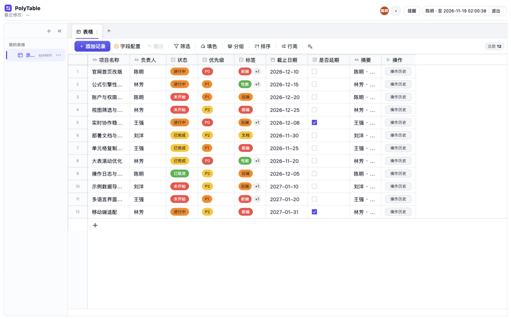
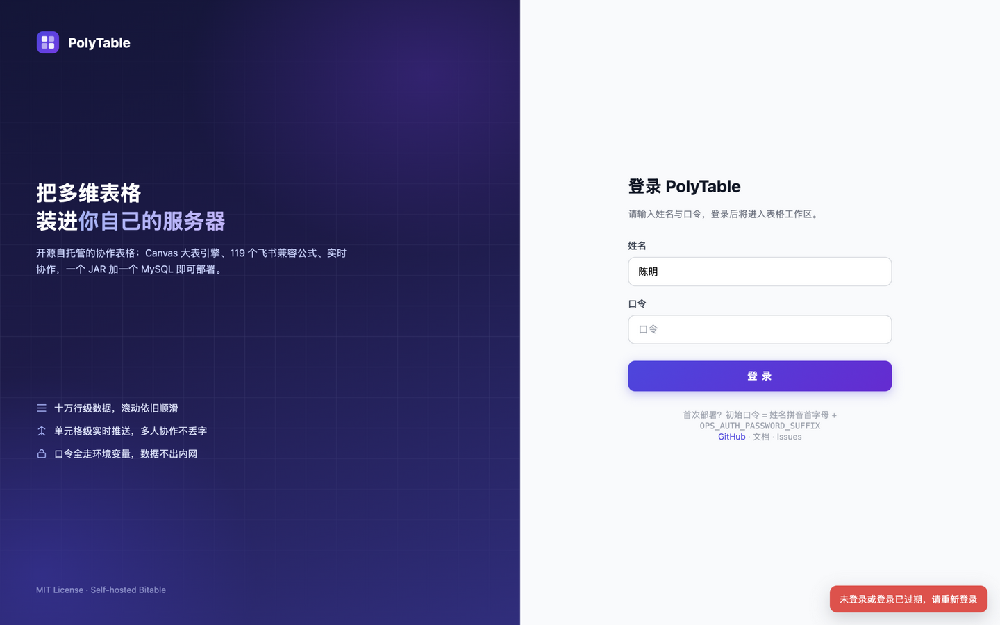

# PolyTable

**Self-hosted multi-dimensional table (Bitable)**

<div align="center">

[](https://github.com/ricky-chenzhuquan/polytable/actions/workflows/ci.yml)
[](LICENSE)
[](https://adoptium.net/)

**[English](README.md) · [简体中文](README.zh-CN.md)**



**Canvas big-grid engine** · **Feishu-compatible formulas** · **Realtime collaboration** · **Lightweight self-hosting**

</div>

> Put a Feishu Bitable-style collaborative table on your own server: a canvas-rendered grid that stays smooth at
> 100k-row scale, 119 Feishu-compatible formula functions, SSE realtime collaboration, MySQL storage — all in a
> single Spring Boot JAR.

<details>
<summary>More screenshots</summary>

| Sign-in | Workspace |
|---|---|
|  |  |

</details>

## What is it

PolyTable is a **self-hosted multi-dimensional table service**, modeled on the core experience of Feishu Bitable:

| Capability | Details |
|---|---|
| 🖥 Canvas big-grid engine | Smooth scrolling at 100k-row scale (50k rows × 70 columns, scroll p95 8.7ms), sparse columnar gzip transfer, keyset pagination |
| 🧮 Formula engine | 119 functions + 14 operators, compatible with the Feishu Bitable formula catalog (with official documentation provenance and golden tests) |
| 🤝 Realtime collaboration | SSE per-cell push, presence (who is editing which cell), operation log with undo |
| 🗂 Views & fields | Text / single-select / multi-select / date / checkbox / formula / lookup fields; filters, sorting, grouping, shared views |
| 🔐 Auth & permissions | Stateless HMAC tokens, role-based menu permissions, account admin panel; all credentials injected via environment variables |
| 📦 Lightweight self-hosting | A single Spring Boot JAR + one MySQL, one command with Docker Compose |
| 🌗 Themes & dark mode | Light / dark / follow system; 5 accent presets switch live (canvas included) |
| 🌐 Bilingual UI | Auto-matches visitor language (zh* → Chinese, otherwise English), `?lang=` override, manual choice persists |

**Performance and architecture details: [docs/architecture.md](docs/architecture.md) and [docs/performance.md](docs/performance.md).**

## Quick start

### Option 1: Docker Compose (recommended)

```bash
git clone https://github.com/ricky-chenzhuquan/polytable.git
cd polytable
cp .env.example .env          # fill in the credentials
docker compose up -d
# open http://localhost:8080/ops/
```

### Option 2: Run from source

Requires JDK 17+, Maven 3.8+, MySQL 8.

```bash
git clone https://github.com/ricky-chenzhuquan/polytable.git
cd polytable
mvn spring-boot:run -Dspring-boot.run.arguments="--DB_USERNAME=root --DB_PASSWORD=yourpassword"
# open http://localhost:8080/ops/
```

First startup automatically creates the `ops_*` tables, demo accounts and a sample table:

- **Demo accounts**: `陈明` / `林芳`; default password = pinyin initials of the name + `OPS_AUTH_PASSWORD_SUFFIX` (with no suffix configured, the password is just the initials `CM` / `LF` — local trials only)
- **Sample table** `tbl_u_demo`: demo data covering select, multi-select, date, checkbox and formula columns
- **System admin**: set `OPS_ADMIN_USERNAME` / `OPS_ADMIN_PASSWORD` and manage accounts & roles at `/ops/admin.html`

### Key environment variables

| Variable | Description | Required |
|---|---|---|
| `DB_URL` | MySQL JDBC URL (default `jdbc:mysql://localhost:3306/polytable?createDatabaseIfNotExist=true&...`) | No |
| `DB_USERNAME` / `DB_PASSWORD` | Database credentials | Recommended |
| `OPS_AUTH_PASSWORD_SUFFIX` | Initial-password suffix (initial password = pinyin initials + suffix) | Required in production |
| `OPS_AUTH_TOKEN_SECRET` | HMAC signing key for login tokens; if unset a random key is generated per startup and **all sessions are invalidated on restart** | Required in production |
| `OPS_ADMIN_USERNAME` / `OPS_ADMIN_PASSWORD` | Admin account for the account-management page (`/ops/admin.html`) | Required in production |
| `OPS_LIST_MAX_PAGE_SIZE` | Max rows per list request (default 50000) | No |
| `DEMO_SEED_ENABLED` | Whether first startup seeds a sample table (default `true`) | No |
| `OPS_TENANT_ENABLED` | Multi-tenant host-based domain split, off by default | No |

Full configuration with inline comments: [src/main/resources/application.yml](src/main/resources/application.yml).

## When to use PolyTable

- **Compliance & data sovereignty** — sensitive ledgers, client lists, and project trackers that must stay inside your network
- **Tens of thousands of rows** — Excel sharing and DOM-based open-source grids get sluggish at this scale; canvas rendering does not
- **Migrating off Feishu / Excel** — 119 Feishu-compatible formulas carry over existing skills; the migration kit moves data with accounts intact
- **A five-minute internal workspace** — `docker compose up -d`, and accounts, roles and a sample table are seeded automatically

## Feature list

- Tables: create / rename / delete blank tables, managed in a registry (`ops_table_registry`)
- Fields: text, single-select, multi-select, date, checkbox, formula, lookup; custom fields, options and colors
- Rows: cell editing, batch paste (with undo), soft delete / restore, optimistic-lock version guard
- Views: filter / sort / group / multiple shared views (`ops_table_views`)
- Formulas: 119 functions + 14 operators, dependency-graph cascading recalc, full golden tests on official examples
- Collaboration: SSE per-cell push + heartbeat, presence, row-level operation log, incremental delta polling
- Engineering: columnar gzip encoding (dense / sparse v2 / binary), metaOnly polling, stale-while-revalidate cache, load-shedding protection

## Documentation

| Document | Contents |
|---|---|
| [docs/architecture.md](docs/architecture.md) | Three-layer architecture, three data-loading protocols, collaboration kernel design (incl. gap list vs Feishu Bitable) |
| [docs/performance.md](docs/performance.md) | 50k × 70 load-test chronicle: root causes and before/after numbers |
| [docs/performance-guardrails.md](docs/performance-guardrails.md) | Hot-path red lines, cache invalidation contracts, unthrottled measurement methodology |
| [docs/design/formula-engine.md](docs/design/formula-engine.md) | Formula engine design: AST, typed value model, dependency graph & caching |
| [docs/formula-catalog.md](docs/formula-catalog.md) | The 119-function compatibility catalog and its provenance |
| [docs/roadmap.md](docs/roadmap.md) | Shipped capabilities and the public roadmap |
| [migration/README.md](migration/README.md) | Data migration from legacy deployments / version upgrades (SQL scripts & verification) |
| [docs/donate.md](docs/donate.md) | Support the author: donation QR codes / other ways to help |

## Website

The static website lives in [website/](website/index.html) and deploys automatically via GitHub Pages (see `.github/workflows/deploy-pages.yml`).

## Security notes

- All credential-like configuration is read from environment variables; **no default passwords are built into the code or config files**
- Login tokens are stateless HMAC-SHA256 signed tokens, default 24h expiry
- Known limitation: password digests currently use a plain SHA-256 scheme (see `OpsAuthService#hashPassword`); upgrading to BCrypt is on the roadmap. In production keep MySQL network-isolated and force users to change their initial password
- Please report vulnerabilities privately via [SECURITY.md](SECURITY.md)

## Disclaimer

PolyTable is not affiliated with Feishu or Airtable. The Feishu Bitable formula-compatibility catalog is independently compiled from their public documentation (with source references) and only describes compatibility goals.

## Support the author ☕

PolyTable is free and open source under MIT, forever. If it helps you, a coffee is always appreciated — scan either code:

<p align="center">
  
  &nbsp;&nbsp;&nbsp;&nbsp;
  
</p>
<p align="center"><sub>Left: WeChat Pay · Right: Alipay</sub></p>

Other ways to help: give the repo a ⭐ star, open issues or PRs, or recommend PolyTable to teams that need it — see [docs/donate.md](docs/donate.md).

## License

[MIT](LICENSE) © 2026 PolyTable contributors
